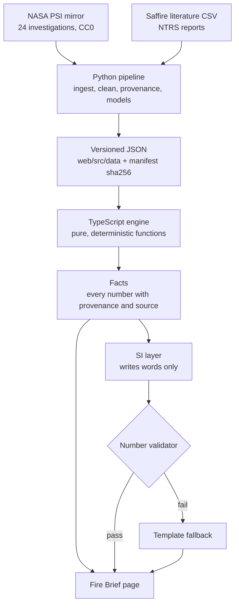

# HALO

**Habitat Assessment from Low-gravity Observations**

In microgravity, a flame becomes a halo. HALO turns NASA's microgravity fire data into a one-page fire brief for your habitat.

[](LICENSE)
[](https://www.spaceappschallenge.org/2026/challenges/flame-in-freefall/)
[](docs/DATA.md)

Pick a habitat atmosphere, cabin materials and smoke detectors. HALO shows which NASA tests are closest, how much evidence covers them, where the evidence stops, what your detector would likely miss, and which test should fly next. Every number is cited to its source.

**Live demo:** https://halo-fire-brief-maanavkrishnas-projects.vercel.app

---

## Built for NASA Space Apps Challenge 2026: Flame in Freefall

[Flame in Freefall: SI-Powered Fire Safety Insights from Microgravity Combustion Data](https://www.spaceappschallenge.org/2026/challenges/flame-in-freefall/) (14–15 November 2026). In Space Apps 2026, "SI" means Super Intelligence, the challenge's term for AI.

The challenge asks for an SI-powered tool that summarizes, ranks and interprets the 24 combustion investigations in NASA's Physical Sciences Informatics (PSI) repository, so habitat and equipment designers can use data that is otherwise hard to navigate. HALO answers its three goals with one input and one answer:

| Challenge goal | How HALO answers it |
|---|---|
| Investigations most relevant to crew habitats | A transparent, weighted ranking of all 24 investigations for the habitat you enter, with each score component shown. |
| Data for predictive flammability modeling | Evidence distance from your atmosphere to every eligible test, per fuel class, plus a bootstrapped droplet self-extinction model fitted to FLEX data. |
| Research that informs next-generation fire-safety equipment | A detector blind-spot analysis from SAME/SAME-R flight runs with a sensor what-if, and a computed "next test to fly" that closes the largest evidence gap. |

## Why it matters

NASA's fire-safety work focuses on prevention, detection and suppression; three spacecraft emergencies show why: [Apollo 1](https://sma.nasa.gov/sma-disciplines/accllp/apollo-1) (1967, a flash fire in a 100% oxygen cabin during a pre-launch test), [Apollo 13](https://sma.nasa.gov/sma-disciplines/accllp/apollo-13) (1970, an oxygen-tank failure and explosion, a fire hazard, after heaters degraded the tank's Teflon wire insulation) and the [Mir fire](https://www.nasa.gov/history/25-years-ago-fire-aboard-space-station-mir/) (1997, a solid-fuel oxygen generator that filled the station with smoke).

Moon-base and exploration habitats plan to run oxygen-enriched, low-pressure atmospheres: at least 30% O2 at no more than 10.2 psi ([challenge statement](https://www.spaceappschallenge.org/2026/challenges/flame-in-freefall/)), and an exploration atmosphere of 34% O2 at 8.2 psia ([NTRS 20150021491](https://ntrs.nasa.gov/citations/20150021491)). Fire behaves differently there, and in microgravity. The PSI evidence was mostly gathered somewhere else:

- **No real cabin material in the PSI data was tested at Moon-base oxygen.** Real solid materials in the PSI test rows were never burned above 22.2% O2 (BASS-II 13.6–22.2%, Saffire-I/II/III 21.0–22.1%). Their pressure is not tabulated; HALO assumes cabin pressure of about 1 atm. Outside PSI, NASA technical reports on Saffire VI describe SIBAL fabric and PMMA burned at 30.3–31.0% O2 and about 7.9 psia (literature); those runs are not PSI test rows, so HALO states them but does not grade on them.
- **Only a surrogate reached Moon conditions.** In the Moon window (≥ 30% O2, ≤ 10.2 psia) there are 33 eligible rows: 20 ACME CFI-G gas flames and 13 ACME BRE rows. BRE is a gas-fed porous burner that emulates a burning solid, with pressure inferred from its stated objectives. None of the PSI rows is a real solid; the only real solids burned there are the Saffire VI literature runs above.
- **The ISS-style scatter detector read low on two cabin materials.** In SAME/SAME-R flight runs it read below the 2.0 V alarm proxy in 20 of 35 Kapton runs and 18 of 23 Teflon runs. All of those runs were in ISS air (21% O2, 1 atm), so smoke behavior at habitat atmospheres is untested.
- **No partial-gravity data.** PSI holds no partial-gravity combustion data, so lunar and Martian gravity are outside the evidence entirely. The challenge expects future PSI data from [LUCI](https://ntrs.nasa.gov/citations/20250010653) and [FM2](https://www.nasa.gov/glenn/glenn-expertise-space-exploration/physical-sciences-program/combustion-science/flammability-of-materials-on-the-moon-fm2/); [SoFIE](https://www.nasa.gov/glenn/glenn-expertise-space-exploration/physical-sciences-program/combustion-science/solid-fuel-ignition-and-extinction-sofie/) and the JAXA-led [FLARE](https://www.nasa.gov/glenn/glenn-expertise-space-exploration/physical-sciences-program/combustion-science/flammability-limits-at-reduced-g-experiment-flare/) study material flammability limits in microgravity. None has data in PSI yet, so HALO names them and grades on none of them.
- **Suppression: the inert gas matters.** In FLEX droplet burns, flames went out on their own more often when the inert gas was CO2 or helium instead of nitrogen, compared at the O2 levels all three were run at. These are flames self-extinguishing in a diluted atmosphere, not tests of an extinguisher (see the suppression card on `/findings`).
- **The standard screening test may not be conservative.** BASS results indicate that NASA-STD-6001 Test 1 ([NASA-STD-6001B](https://standards.nasa.gov/standard/NASA/NASA-STD-6001)) is not conservative: materials can burn at lower oxygen in microgravity than on Earth ([A Researcher's Guide to Combustion Science, 2015](https://www.nasa.gov/missions/station/a-researchers-guide-to-combustion-science/)).

## What you get in a Fire Brief

| Section | What it shows |
|---|---|
| **Readiness grade (A–F)** | How well tested evidence covers your atmosphere, overall and per fuel class. Grades describe evidence coverage, not safety. On the full dataset: ISS **B**, Moon envelope **C**, Artemis base **D**, EVA suit **F**. |
| **Evidence distance** | Distance from your habitat to the nearest eligible test in each fuel class (solid, solid surrogate, droplet, gas), and whether that test's O2 and pressure were measured, assumed or inferred. |
| **Ranked investigations** | All 24 PSI investigations ordered by proximity, fuel relevance, hazard coverage and data richness, with short "why" notes. |
| **Detector blind spot + sensor what-if** | For each listed material with a SAME analog: how many flight runs the scatter detector would have missed, smoke particle size, and how many runs scatter plus ionization would have flagged. Shown as "x of y runs". |
| **Droplet self-extinction** | "Will it go out on its own?" for liquid droplet fuels: probability with a 95% bootstrap band from the FLEX model, flagged when your pressure is outside the tested 0.7–1.0 atm. |
| **Aftermath (Saffire VI)** | Literature results from Saffire VI (NASA reports, not PSI test rows): flame power and toxic-gas load from PMMA burns in an oxygen-enriched, low-pressure atmosphere inside the Moon envelope. Per [NTRS 20260001992](https://ntrs.nasa.gov/citations/20260001992), CO exceeded the 24-hour Spacecraft Maximum Allowable Concentration ([JSC 20584](https://ntrs.nasa.gov/citations/20240007713), 100 ppm) and approached, but did not exceed, the 1-hour SMAC (425 ppm); CO2 exceeded the NASA-STD-3001 Vol 2 1-hour limit (3 mmHg). Stated with a `literature` badge; not used for the grade. |
| **Cool-flame note** | When liquids are present: FLEX heptane droplets kept burning on an invisible ~500–800 K cool flame after the visible flame went out. |
| **Next test to fly** | A computed (not hand-written) candidate test, plus diverse runners-up, chosen to reduce evidence distance most across the habitat presets. |
| **Earth relevance** | Three NASA Spinoff facts linking the findings to fire safety on Earth. |
| **Citations** | Every number is a fact with a provenance and a source: PSI id, dataset DOI or NTRS/Spinoff URL. |
| **Print/PDF and shareable URL** | The full habitat is encoded in the query string, for example `/brief?o2=34&p=8.2&f=10&m=kapton,teflon,cotton&d=scatter&l=0&n=Artemis%20Base`. |

## How it works



1. **Pipeline** (`pipeline/`, Python). Reads the vendored PSI experimental tables, detail records and the SAME workbook. Normalizes units, records where each value came from, applies documented data-quality fixes, and fits the extinction model. 1,967 rows in, 1,225 eligible for habitat coverage.
2. **Versioned JSON** (`web/src/data/`). Static files with a `manifest.json` that records build time, row counts, the sha256 of each file and every PSI dataset DOI. The app imports them at build time and validates them once with zod.
3. **Engine** (`web/src/lib/engine/`, TypeScript). Pure functions that turn a habitat and the data into a `Brief`. No randomness at run time, no network.
4. **SI layer.** Numbers come from code; words come from SI. The SI only writes narrative over the frozen facts object. A validator rejects any sentence containing a number that is not a fact value, and the brief falls back to a template. Build-time summaries of all 24 investigations (in `web/src/data/summaries.json`) follow the same rule: tags from a closed vocabulary, quotes checked against the source text.

### Provenance badges

Every number in a brief carries one of these badges.

| Badge | Meaning |
|---|---|
| `measured` | Reported in the PSI data tables. |
| `assumed` | Not recorded; assumed from the experiment's documented setup (for example ISS cabin pressure). |
| `inferred` | Derived from other recorded quantities or described only in text. |
| `literature` | Taken from a published paper or report. |
| `computed` | Arithmetic on the data (counts, distances, ranking, O2 partial pressure). |
| `model` | From the fitted FLEX droplet extinction model (extinction probability and its band). |
| `si` | Wording written by an LLM. It never introduces a number that is not a fact value. |

Method details: [docs/METHOD.md](docs/METHOD.md). Brief structure and flag rules: [docs/BRIEF.md](docs/BRIEF.md).

## Data and citation

- **Source.** The NASA Physical Sciences Informatics (PSI) combustion repository: 24 investigations, released under CC0 1.0. HALO cites each investigation by its PSI dataset DOI (`https://doi.org/<doi>`). The full list is in [docs/DATA.md](docs/DATA.md) and in `manifest.json`.
- **Literature.** Saffire IV, V and VI results (and Saffire I and II points) come from NASA technical reports on NTRS, with a URL on every row.
- **Challenge resources.** The [PSI combustion repository](https://psi.nasa.gov/physci/repo/search?q=combustion), the [NASA Glenn Combustion Science](https://www.nasa.gov/glenn/glenn-expertise-space-exploration/physical-sciences-program/combustion-science/) page and its investigation fact sheets, the [ScienceCast video](https://www.youtube.com/watch?v=W1oXykoz9zg), the [Researcher's Guide](https://www.nasa.gov/missions/station/a-researchers-guide-to-combustion-science/), the Apollo 1, Apollo 13 and Mir pages above, and the three NASA Spinoffs are all cited on the site (`/about` lists them with where each is used).
- **Adjacent record.** [PSI-179 ASE](https://doi.org/10.60555/pdgr-c961) (Aerosol Sampling Experiment, Complex Fluids) sampled ISS cabin dust, the background a smoke detector must reject. It is cited as context on `/data`; HALO computes nothing from it.
- **Partner agency research.** The [FLARE](https://www.nasa.gov/glenn/glenn-expertise-space-exploration/physical-sciences-program/combustion-science/flammability-limits-at-reduced-g-experiment-flare/) project, JAXA-led and joined by NASA, ESA and universities in Japan, the USA and France, aims to predict microgravity flammability limits from ground tests. Its results are not in PSI, so HALO cites it and does not grade on it.
- **CSV export.** Every test row with its provenance, flow, outcome, diluent, per-row geometry and dataset DOI, for modelers, at `/data/files/tests.csv` (one file per investigation at `/data/files/tests-PSI-n.csv`).
- **Processing.** Column maps, unit conversions, eligibility rules and every data-quality fix are documented in [docs/DATA.md](docs/DATA.md).

HALO summarizes published NASA test evidence. **It is not a safety certification.** HALO is not affiliated with or endorsed by NASA.

## Quick start

Requirements: Python 3.12+, Node.js and pnpm.

**Pipeline** (rebuilds `web/src/data/*.json` from `data/`):

```bash
cd pipeline && python3 -m venv .venv && .venv/bin/pip install -r requirements.txt && make data
```

**Web app:**

```bash
cd web && pnpm install && pnpm dev
```

Then open http://localhost:3000.

**Tests:**

| Suite | Command | Count |
|---|---|---|
| Engine, page-fact and SI unit tests (Vitest) | `cd web && pnpm test` | 261 tests in 25 files |
| Pipeline tests (pytest) | `cd pipeline && .venv/bin/pytest -q` | 76 tests |
| End-to-end (Playwright, production build on port 3100) | `cd web && pnpm test:e2e` | 85 tests in 7 specs |
| Type check | `cd web && pnpm exec next typegen && pnpm exec tsc --noEmit` | |

**Environment.** Copy [`.env.example`](.env.example) to `.env` (gitignored). It holds the server-only LLM API key and `SI_LIVE` (set to `false` to serve precomputed text only). The data pipeline and the engine need no keys.

## Repository layout

```
.
├── pipeline/     Python data pipeline: PSI tables -> versioned JSON (tests in pipeline/tests)
├── data/
│   ├── raw/      Vendored PSI experimental tables, trimmed detail records, SAME workbook
│   └── literature/  Saffire points transcribed from NTRS reports
├── web/          Next.js app
│   ├── src/data/        Generated JSON data contract (do not edit by hand)
│   ├── src/lib/engine/  Pure TypeScript engine that builds the Fire Brief
│   └── tests/           Vitest engine tests, Playwright e2e, fixtures
├── docs/         Data, method, brief and architecture documentation
├── .githooks/    Pre-commit secret guard
├── LICENSE       Apache-2.0
└── NOTICE        Attribution notices
```

## Pages

| Route | What it is |
|---|---|
| `/` | Landing: why fire safety in space matters (Apollo 1, Apollo 13, Mir), the problem, a live mini brief and the habitat presets |
| `/build` | Habitat builder (atmosphere, materials, detectors, liquids) |
| `/brief` | The Fire Brief for a habitat (shareable URL), with Ask HALO |
| `/findings` | The headline evidence gaps and the suppression finding, each computed and cited |
| `/explore` | All 24 investigations, filterable and sortable |
| `/explore/[psiId]` | One investigation, for example `/explore/PSI-69`; unknown ids return a 404 |
| `/compare` | Two habitats side by side |
| `/investigations/compare?ids=…` | 2–4 investigations side by side, differences marked, overlaid O2 × pressure plot |
| `/materials?m=pmma&o2=34&p=8.2` | Material screener: every PSI row for the material, Saffire literature, SAME smoke stats, the Test 1 caveat and the distance to the nearest evidence |
| `/gravity` | Partial-gravity bounds: microgravity vs 1 g per material, the untested Moon/Mars band, the E-FIELD analogue, LUCI and FM2 |
| `/method` | Every formula, threshold and model |
| `/data` | Sources (PSI, Glenn fact sheets), partner agency research, provenance, fixes, downloads (including the `tests.csv` export) and every DOI |
| `/about` | Who it is for, why it was built, fire history, the challenge and its resources, use of SI, licence |
| `/design` | The living design system |

## Documentation

| Document | Contents |
|---|---|
| [docs/ARCHITECTURE.md](docs/ARCHITECTURE.md) | Repo layout, data flow, security headers, secrets and cost control. |
| [docs/DATA.md](docs/DATA.md) | Sources, column map per investigation, provenance rules, eligibility, data-quality fixes, DOIs. |
| [docs/DATA-CONTRACT.md](docs/DATA-CONTRACT.md) | Shape of every generated JSON file and the provenance vocabulary. |
| [docs/METHOD.md](docs/METHOD.md) | Evidence distance, grades, detector blind spot, ranking, extinction model, next test. |
| [docs/BRIEF.md](docs/BRIEF.md) | Fire Brief sections, flag rules, fact ids and URL parameters. |
| [docs/FETCH.md](docs/FETCH.md) | How to re-fetch full PSI detail records. |
| [pipeline/README.md](pipeline/README.md) | Pipeline setup, modules and tests. |

## Security

- **Headers.** CSP, `X-Content-Type-Options`, `Referrer-Policy`, `Permissions-Policy` and `X-Frame-Options` on every route, set in [`web/next.config.ts`](web/next.config.ts). HTML is never rendered from data or SI output. The e2e test asserts the headers on a production build.
- **Server-only key.** The LLM API key lives only in server environment variables, never in client code. `.env` is gitignored.
- **Pre-commit secret hook.** [`.githooks/pre-commit`](.githooks/pre-commit) rejects staged `.env` files and key-like strings. Enable it with `git config core.hooksPath .githooks`.
- **Rate and spend limits.** A monthly spend limit at the LLM provider, a Vercel Firewall rate limit on the explanation endpoint, a best-effort in-memory per-IP limit in the route and a kill switch (`SI_LIVE=false`).

Rationale: [docs/ARCHITECTURE.md](docs/ARCHITECTURE.md).

## Use of SI (AI)

**In the product.**
- *Build-time summaries (see [docs/SI.md](docs/SI.md)).* An LLM writes a short summary and habitat relevance note for each of the 24 investigations from its PSI record. Output is validated: hazard tags from a closed vocabulary, quotes must appear in the source text, no number the source lacks. All 24 pass the automatic checks; the author's manual read-through against PSI is in progress, so every summary stays labelled as SI output.
- *Live explanations ("Ask HALO" on `/brief`, via `/api/explain`).* An LLM writes a short narrative over the brief's computed facts. Every number it writes must match a fact value, or the brief uses a template instead; a citation whose fact value is not a number in its sentence is dropped, and values describing the habitat cite the `habitat-*` facts.
- Every SI sentence carries an `si` badge. All numbers, grades, rankings and models come from deterministic code.

**In development.** An LLM coding assistant helped write code. All data processing, models and copy were reviewed by the author.

## Team

Maanav Krishna.

## License

Apache-2.0. See [LICENSE](LICENSE) and [NOTICE](NOTICE). PSI data is CC0 1.0.

## Acknowledgements

- NASA Physical Sciences Informatics, for curating and openly releasing the combustion data.
- NASA Glenn Research Center combustion research, behind the investigations HALO draws on.
- The authors of the NASA Space Apps Challenge "Flame in Freefall".
